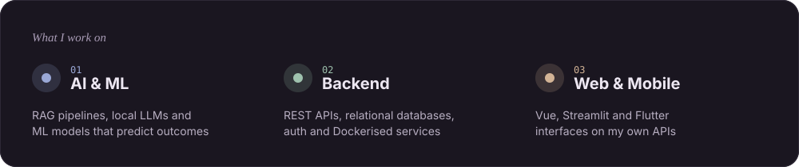
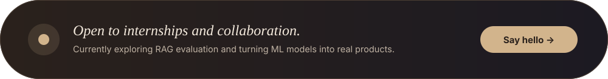

  

  
  
  

> I build **AI-powered applications end to end**: the retrieval pipeline or ML model in Python, the backend around it, and the interface people actually use.
> **Looking for:** internship / junior roles in **AI engineering, backend or full-stack development.**

## Featured work

  
  

  <a href="https://github.com/azraozdas/clarivo">clarivo</a> ·
  <a href="https://github.com/azraozdas/Clarivo_Web">clarivo web</a> ·
  <a href="https://github.com/azraozdas/ade-website">ade-website</a> ·
  <a href="https://github.com/azraozdas/pagerank">pagerank</a> ·
  <a href="https://github.com/azraozdas/chessy">chessy</a>

## Tech stack

  

<b>AI / ML</b> &nbsp;LangChain · ChromaDB · HuggingFace · Ollama (Llama 3.2) · scikit-learn · pandas · Streamlit

 

  

