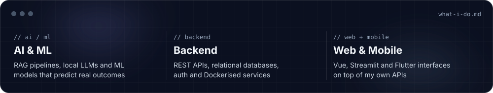
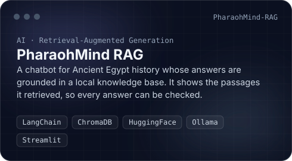
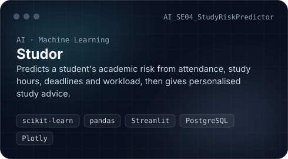
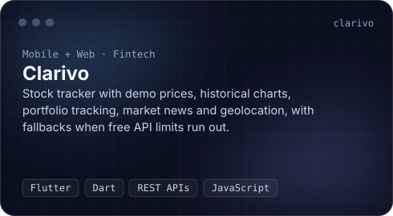
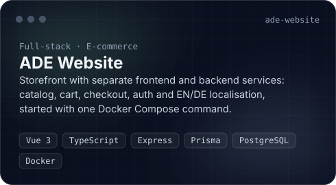
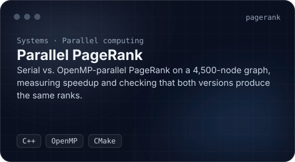
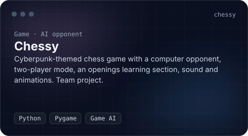
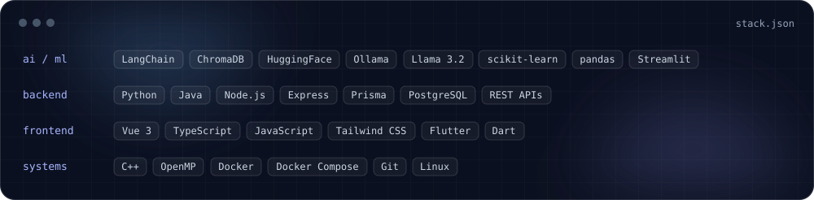
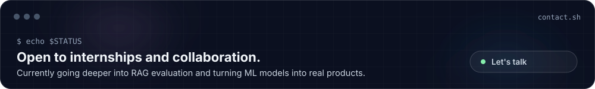

  

  
  
  

  

I build **AI-powered applications end to end**: the retrieval pipeline or ML model in Python, the backend around it, and the interface people actually use.
**Looking for:** internship / junior roles in **AI engineering, backend or full-stack development.**

 

  
  
  
  
  
  

 

  

 

  
  

 

  

