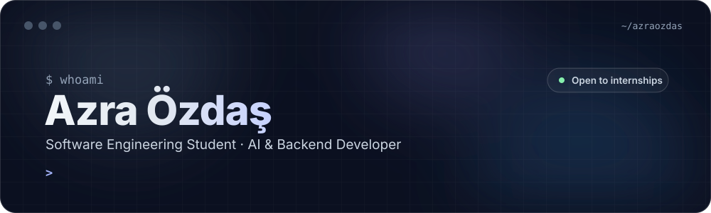

  

  
  
  

 

<table>
<tr>
<td width="33%" valign="top" align="center">
<h3>🧠</h3>
<b>AI &amp; ML</b> 
RAG pipelines, local LLMs, ML models that predict real outcomes
</td>
<td width="33%" valign="top" align="center">
<h3>⚙️</h3>
<b>Backend</b> 
REST APIs, relational databases, auth, Dockerised services
</td>
<td width="33%" valign="top" align="center">
<h3>🌐</h3>
<b>Web &amp; Mobile</b> 
Vue, Streamlit and Flutter interfaces on top of my own APIs
</td>
</tr>
</table>

I build **AI-powered applications end to end**: the retrieval pipeline or ML model in Python, the backend around it, and the interface people actually use.
**Looking for:** internship / junior roles in **AI engineering, backend or full-stack development.**

## ✦ Featured work

<table>
<tr>
<td width="50%" valign="top">

### 🏺 [PharaohMind RAG](https://github.com/azraozdas/PharaohMind-RAG)
**AI · Retrieval-Augmented Generation**

A chatbot for Ancient Egypt history whose answers are grounded in a local knowledge base. It shows the passages it retrieved, so every answer can be checked.

`LangChain` `ChromaDB` `HuggingFace` `Ollama · Llama 3.2` `Streamlit`

</td>
<td width="50%" valign="top">

### 📊 [Studor: Study Risk Predictor](https://github.com/azraozdas/AI_SE04_StudyRiskPredictor)
**AI · Machine Learning**

Predicts a student's academic risk from attendance, study hours, deadlines and workload, then gives personalised study advice. Auth, dashboard and course management included.

`scikit-learn` `pandas` `Streamlit` `PostgreSQL` `Plotly`

</td>
</tr>
<tr>
<td width="50%" valign="top">

### 💹 [Clarivo](https://github.com/azraozdas/clarivo) · [Web](https://github.com/azraozdas/Clarivo_Web)
**Mobile + Web · Fintech**

Stock tracker with live demo prices, historical charts, portfolio tracking, market news and geolocation, with graceful fallbacks when free API limits run out.

`Flutter` `Dart` `REST APIs` `JavaScript`

</td>
<td width="50%" valign="top">

### 🛒 [ADE Website](https://github.com/azraozdas/ade-website)
**Full-stack · E-commerce**

Storefront with separate frontend and backend services: catalog, cart, checkout, auth and EN/DE localisation. The whole stack starts with one Docker Compose command.

`Vue 3` `TypeScript` `Express` `Prisma` `PostgreSQL` `Docker`

</td>
</tr>
<tr>
<td width="50%" valign="top">

### ⚡ [Parallel PageRank](https://github.com/azraozdas/pagerank)
**Systems · Parallel computing**

Serial vs. OpenMP-parallel PageRank on a 4,500-node graph, measuring speedup and checking that both versions produce the same ranks.

`C++` `OpenMP` `CMake`

</td>
<td width="50%" valign="top">

### ♟️ [Chessy](https://github.com/azraozdas/chessy)
**Game · AI opponent**

Cyberpunk-themed chess game with a computer opponent, two-player mode, an openings learning section, sound and animations. Team project.

`Python` `Pygame` `Game AI`

</td>
</tr>
</table>

## ✦ Tech stack

   
  

| | |
|---|---|
| 🧠 **AI / ML** | LangChain · ChromaDB · HuggingFace · Ollama (Llama 3.2) · scikit-learn · pandas · Streamlit |
| ⚙️ **Backend** | Python · Java · Node.js · Express · Prisma · PostgreSQL · REST APIs |
| 🌐 **Frontend & Mobile** | Vue 3 · TypeScript · Tailwind CSS · Flutter |
| 🛠 **Systems & DevOps** | C++ · OpenMP · Docker · Docker Compose · Git |

## ✦ On GitHub

  
  

## ✦ Right now

- 🔍 Going deeper into **RAG evaluation** and running LLMs locally
- 🚀 Turning ML models into real products with a clean API and UI
- 🤝 Open to internships and collaboration: [LinkedIn](https://www.linkedin.com/in/azra-ozdas/) · [azraozdas.main@gmail.com](mailto:azraozdas.main@gmail.com)

 

  

