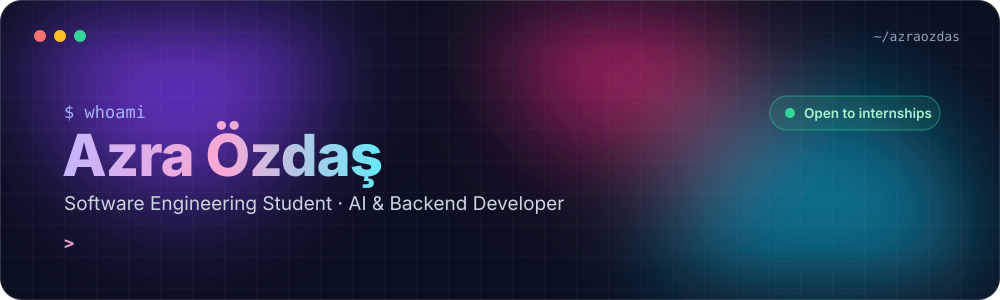

<!-- HEADER -->

  

  

  

---

### 👋 In one sentence

Software Engineering student who builds **AI-powered applications end to end**: retrieval pipelines and ML models in Python, a REST backend around them, and a web or mobile UI on top.

**Looking for:** internship / junior roles in **AI engineering, backend or full-stack development**.

---

### 🚀 Featured work

<table>
<tr>
<td width="50%" valign="top">

#### 🏺 [PharaohMind RAG](https://github.com/azraozdas/PharaohMind-RAG)
**Retrieval-Augmented Generation chatbot** for Ancient Egypt history. Answers are grounded in a local knowledge base and the retrieved passages are shown to the user, so every answer can be checked.

`LangChain` `ChromaDB` `HuggingFace embeddings` `Ollama · Llama 3.2` `Streamlit`

</td>
<td width="50%" valign="top">

#### 📊 [Studor: Study Risk Predictor](https://github.com/azraozdas/AI_SE04_StudyRiskPredictor)
**Machine learning app** that predicts a student's academic risk from attendance, study hours, deadlines and workload, then gives personalised study recommendations. Includes auth, dashboard and course management.

`Python` `scikit-learn` `pandas` `Streamlit` `PostgreSQL` `Plotly`

</td>
</tr>
<tr>
<td width="50%" valign="top">

#### 💹 [Clarivo: Stock Tracker](https://github.com/azraozdas/clarivo) · [Web](https://github.com/azraozdas/Clarivo_Web)
Fintech-style **mobile + web app**: live demo stock prices, historical charts, portfolio tracking, market news and geolocation, with graceful fallbacks when free API limits are hit.

`Flutter` `Dart` `REST APIs` `JavaScript`

</td>
<td width="50%" valign="top">

#### 🛒 [ADE Website](https://github.com/azraozdas/ade-website)
**Full-stack storefront** with separate frontend and backend services: catalog, cart, checkout, auth and EN/DE localisation. The whole stack starts with one Docker Compose command.

`Vue 3` `TypeScript` `Express` `Prisma` `PostgreSQL` `Docker`

</td>
</tr>
<tr>
<td width="50%" valign="top">

#### ⚡ [Parallel PageRank](https://github.com/azraozdas/pagerank)
Serial vs. **OpenMP-parallel** PageRank on a 4,500-node graph, measuring speedup and verifying both versions produce the same ranks.

`C++` `OpenMP` `CMake`

</td>
<td width="50%" valign="top">

#### ♟️ [Chessy](https://github.com/azraozdas/chessy)
Cyberpunk-themed chess game with an **AI opponent**, two-player mode, an openings learning section, sounds and animations. Team project.

`Python` `Pygame` `Game AI`

</td>
</tr>
</table>

---

### 🧰 Tech stack

   
   
  

| Area | Tools |
|---|---|
| **AI / ML** | LangChain, ChromaDB, HuggingFace, Ollama (Llama 3.2), scikit-learn, pandas, Streamlit |
| **Backend** | Python, Java, Node.js, Express, Prisma, PostgreSQL, REST APIs |
| **Frontend & Mobile** | Vue 3, TypeScript, Tailwind CSS, Flutter |
| **Systems & DevOps** | C++, OpenMP, Docker, Docker Compose, Git |

---

### 📈 GitHub activity

  
  

---

### 🌱 Right now

- Going deeper into **RAG evaluation** and running LLMs locally
- Turning ML models into real products with a clean API and UI
- Open to internships and collaboration — say hi 👋

  

